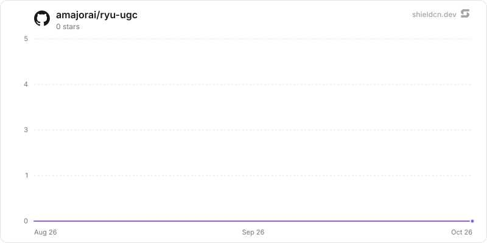

<p align="center">
  <picture>
    <source media="(prefers-color-scheme: dark)" srcset="./icon-dark.png" />
    
  </picture>
</p>

<div align="center">

# UGC

</div>

Run creator-marketing campaigns end to end: briefs and budgets, a creator roster, post submissions with approve/reject review, post metrics refreshed through a curated Composio action map, and CPM/flat-rate payouts accrued, approved and marked paid.

> **The public home of `ryu-ugc`.** Source, builds, and releases live here —
> binaries for every platform are attached to each release.
>
> This tree is generated from the Ryu monorepo, so commits pushed here
> directly are replaced on the next sync. **Pull requests are welcome** —
> open them here and they are ported into the monorepo, then flow back out.
> Ryu as a whole: https://github.com/amajorai/ryu

## Install

**App:** [Install](ryu://apps/@ryu/ugc) (opens the Ryu desktop app and asks you to confirm)

**CLI:**

```bash
ryu apps add @ryu/ugc
```

**From source:**

```bash
cargo build --release --manifest-path backend/Cargo.toml
```

Prebuilt binaries for every platform are attached to [each release](https://github.com/amajorai/ryu/releases).

## License

Apache-2.0 — see [LICENSE](./LICENSE).

## How a refresh reaches Composio

The backend sends a provider-neutral `ManagedProviderCall` through Ryu's Core → Gateway
bridge. Gateway supplies the managed Composio credential, executes the action, and
records provider cost against the organization wallet. The UGC process receives only
the result and never stores a provider key.

Two details of that bridge are load-bearing here:

- **The tool argument is the BARE action slug** — `YOUTUBE_VIDEOS_LIST`, not
  `composio.YOUTUBE_VIDEOS_LIST`. The slug is an operation identifier; only Gateway
  turns it into an upstream request.
- **The sidecar never constructs an upstream URL or credential header.** Core
  authenticates the sidecar, Gateway validates the operation against its managed
  provider configuration, and the provider response metadata drives the wallet
  transaction.

`MetricOutcome` has two arms, and the second is **not** a failure:

```rust
pub enum MetricOutcome {
    Ok(Value),                                         // Composio's `data`, unwrapped
    NeedsConnection { message: String, url: Option<String> },
}
```

`NeedsConnection` means the operator has not linked that platform's account yet. It is
reported as its own per-submission status, never as an error and never as a reading:
`RefreshOutcome::NeedsConnection` is *structurally* incapable of carrying a snapshot, so
nothing is written and no payout is re-priced. Inventing zeroes there would silently
re-price a live payout down to nothing on the next accrual pass.

### Refresh wire shape

Both `POST /submissions/:id/refresh` and `POST /campaigns/:id/refresh` report the
identical per-submission line, with every field always present (`null` rather than
omitted) so a consumer can switch on `status` without probing for keys:

```json
{ "submission_id": "sub_…", "status": "ok" | "needs_connection" | "error",
  "message": null, "connect_url": null, "snapshot": null }
```

The campaign-wide route adds counts `{ "ok": n, "needs_connection": n, "error": n }`.
`needs_connection` is counted apart from `error` on purpose: "link your TikTok account"
and "that action id does not exist" are different jobs for whoever reads the response,
and one platform being unlinked never fails the batch.

## Managed provider routing

Metric refreshes use Ryu's provider-neutral Core → Gateway bridge. Gateway supplies
the managed Composio credential and records provider cost against the organization
wallet. The UGC sidecar has no Composio key file, key-setting route, or provider-key
fallback; `/api/ugc/platforms` reports whether the managed provider is available.

## Parts

- **`backend/` (`ryu-ugc`)** — the whole app: the SQLite `UgcStore`, the accrual engine,
  the curated Composio map, and the `/api/ugc/*` HTTP surface. Served **out-of-process**
  by the `ryu-ugc` bin (`[[bin]]`, `kind: local`, `public_mount`, `RYU_UGC_BIN` /
  `RYU_UGC_PORT`, default `:8004`); Core links **zero UGC code** (no path-dep, no
  `ugc_client.rs`, no `/api/ugc` route in `server/mod.rs` — the public mount is derived
  from this manifest at router-build time). The one remaining process concern (where
  provider routing is handled by the managed `ProviderRouter`, so the crate has
  **zero dependency on `apps/core`**.
- **No `ui/`.** There is no companion, no `dist/index.html`, and no
  `plugin_manifest/fixtures/ugc.ui.html`. The surface is a **native desktop dock panel**
  registered under the key `@ryu/ugc/ugc` in `NATIVE_DOCK_PANELS`, which fetches
  `/api/ugc/*` directly. A companion frame runs under CSP `connect-src 'none'` and could
  only reach the host through per-app RPC verbs in `packages/app-host` plus rows in
  `crates/core/kernel-contracts` — i.e. exactly the per-app Core coupling `AGENTS.md`
  forbids. `runnables: []`.

## Manifest (`manifest.json`)

- **Sidecar:** `ugc` on `:8004`, `command: "ryu-ugc"`, `command_env: RYU_UGC_BIN`,
  `port_env: RYU_UGC_PORT`, `health_path: /health`, **`lazy: true`** with
  `idle_stop_secs: 300`. Declared routes include `/`, `/health`, `/platforms`;
  `/campaigns` + `:id` + per-campaign
  `summary`/`leaderboard`/`submissions`/`refresh`; `/creators` + `:id`; `/submissions` +
  `:id` + per-submission `review`/`metrics`/`refresh`; `/payouts` + `:id` +
  `approve`/`paid`.
- **Grants:** `tools.invoke` for the managed provider bridge; the sidecar declares
  the same grant under `host_api`.
- **Levels:** `ugc.view` · `ugc.manage` (implies view) · `ugc.payouts` (implies view).
  Payout settlement is its own level because marking a payout paid **freezes its
  amount**: a paid row is never re-priced, so the act is the campaign's spend record,
  not a status change.
- **Contributes:** three blocks, all of them consumed. The `ugc` dock panel
  (`panel: "native"`, both docks), the `surface:ugc` list-detail view, and six hook
  events. Core serves all three from `GET /api/plugins/contributions`.

  Two blocks were declared here and have been **removed**, because neither could ever
  take effect and a declaration nothing honours is a claim the product does not keep:

  - `data_categories.campaigns` — Core resolves a category id through the closed table
    `DataCategory::from_id` (`server/data_admin.rs`), which knows
    `chats|spaces|memory|monitors|meetings` and nothing else. An unknown id is skipped
    with a warn, so the Settings danger-zone row never rendered. Backing it would take a
    new Core variant reaching into this app — the per-app Core coupling `AGENTS.md`
    forbids. Deleting a campaign is `DELETE /api/ugc/campaigns/:id`, which cascades in
    Rust — and refuses (409, nothing changed) while any of its payouts is paid, as do
    `DELETE /api/ugc/creators/:id?force=true` and `DELETE /api/ugc/submissions/:id`.
  - `quotas.maxCampaigns` — a manifest quota only bites if the billing catalog carries
    the key *and* a client guards on it. `maxCampaigns` appears in neither
    (`packages/auth/src/lib/plans.ts` has no such row, and nothing calls
  `guard("maxCampaigns", …)`), so the cap was inert in both halves. Marketplace app
  and plugin features now remain outside plan quotas; genuine resource caps belong
  to the Core-owned registry and an explicit create-site guard.

### `http.routes` is enforcing, not advisory

`resolve_route` walks this list and 404s a path no row matches — the request never
reaches the sidecar. So the list must be exhaustive and must spell `:id` exactly as the
axum router does. `"/"` is required on its own row: `public_mount_routes` registers
the bare mount and the `/*rest` wildcard as two separate axum routes, so without it a
bare `GET /api/ugc` 404s. The trailing-slash form `/api/ugc/` is deliberately never
registered (axum panics on it) and will not work.

## Why `lazy: true` — and the scheduler that is not here

Reasonable to expect the opposite: an app that refreshes post metrics sounds like it
wants a background loop, and `apps-store/dashboards` says in its own description that it
is started **eagerly** precisely so its refresh loop can run before any desktop opens.

This app is not that, as specified. Every refresh has an HTTP caller
(`POST /campaigns/:id/refresh` and `POST /submissions/:id/refresh`), and the schema has no
`next_run_at`, no queue, and no scheduler table: nothing in it creates work with no
request behind it. `idle_stop_secs` is the field that would kill an in-process timer, so
the two move together, and both point the same way here. The posture is browser's and
simulator's: an opt-in app nobody opens costs a boot nothing, and the first ext-proxy hit
from the dock panel wakes it behind a bounded health-wait.

**If** a nightly refresh sweep is added later, this is the line that has to change —
drop `lazy` and `idle_stop_secs` together and say why in the description, as dashboards
does. Do not keep `idle_stop_secs` and add a timer: the process would be reaped
mid-window and the sweep would silently stop happening.

## Auth / security

The sidecar binds **loopback only** and fail-closes: every `/api/ugc/*` route requires a
bearer resolved as `RYU_EXT_TOKEN` (Core's per-plugin secret, re-stamped on each proxied
hop). With no token configured, every protected route rejects 401. `GET /health` is the
one un-gated route, so Core's pre-auth probe succeeds before the token is presented. The
The managed provider bridge is protected by the sidecar's `tools.invoke` host grant.

Composio actions are `&'static str`s from the curated table — a campaign cannot name
one. `checked_action` screens each slug before it becomes a URL path segment, because
`dispatch` interpolates it into `{base}/tools/execute/{tool}` with no percent-encoding: a
slug carrying `/` or `..` would not name an action, it would rewrite the path of a
managed provider request. The same guard screens the platform-native post
id parsed out of `submissions.post_url` — the ONE dynamic value this app ever hands to a
Composio action.

## Host grants

This app declares `tools.invoke` under `permission_grants` and `sidecars[].host_api`
because metric refreshes cross the managed provider bridge. The provider key itself
remains outside the app.

The one Core capability the backend still uses is `events.emit`, and its row in
`KERNEL_CAPABILITIES` (`sidecar/ext_proxy.rs`) carries `grant: None` — so
`host_capability` skips the grant intersection entirely for it and dispatches straight
to `host_events_emit`. That row is not "unguarded": it is authorized by **ownership**,
which is tighter than any grant could be. `may_emit_event` requires the authenticated
caller to be the plugin the event id is namespaced to *and* to have declared that exact
id in its own `contributes.hook_events`. The widest possible abuse of a stolen grant
would be "an app emits its own events", which is the entire intended use.

`SidecarSpec::host_api`'s own doc says "Absent = the sidecar may not call back into Core
at all (deny-all)", which reads like a contradiction and is worth not re-litigating: that
sentence describes the **grant-gated** `/api/host/*` surface, which is the only thing
`host_api_grant_usable` is consulted for. A `grant: None` kernel capability never reaches
that check. `apps-store/quests` is the standing proof — it ships `ryu-app-events` and
declares no `host_api` either.

That ownership check is also why the six ids below and the `EventEmitter::emit`
arguments must be **byte-identical**: one character off and Core 403s, which `emit()`
logs and swallows, so it fails silently.

Not declared, on purpose: `sidecar:process`. A Core-tier built-in's sidecar spawns on
the unconditional auto-run path, and the Gateway *validates and denies* that grant at
enable — declaring it would make the enable itself fail.

## Hook events

Past tense, named for what happened. All six are raised by the backend (`lib.rs`
`EVENT_*` constants; none is declared-but-never-emitted). Each description states whether
it can re-fire for the same subject, because that is the only thing a consumer cannot
infer:

| id | re-fires? |
| --- | --- |
| `@ryu/ugc#submission.received` | once per row created; a duplicate post is a 409 under any platform label |
| `@ryu/ugc#submission.approved` | transition-gated (pending → approved) |
| `@ryu/ugc#submission.rejected` | transition-gated |
| `@ryu/ugc#metrics.refreshed` | **every** successful refresh, unchanged counters included |
| `@ryu/ugc#payout.accrued` | only when `amount_cents` changes; paid rows never emit |
| `@ryu/ugc#campaign.budget.reached` | once on the crossing; re-arms if the budget is raised |

A `needs_connection` refresh emits nothing — `metrics.refreshed` fires only on the
branch that actually wrote a snapshot, so an unlinked account never looks like a reading
of zero to a downstream workflow.

## Permission levels are vocabulary, not a gate

The three levels are **reachable** — `GET /api/acl/vocabulary` merges every installed
app's `permission_levels` into one flat namespace, which is how a grant picker learns
`ugc.payouts` exists and that it implies `ugc.view`. They are not **enforced**: a route is
gated only when its `http.routes[]` row carries a `permission`, absent by default, and
none of the campaign rows here carries one. So today every level is grantable and
describes intent honestly, while the proxy forwards the declared routes to any caller
who reaches the mount. Annotating them is the follow-up; it is a behaviour change, not a
doc fix — annotate the campaign mutation rows first when that follow-up happens.

## Swap seam

The platform map is data: one row per platform carrying the action id, the id argument,
constant extra args, and the dotted selectors. Correcting a platform (including
swapping the managed provider implementation is a one-line edit to one row plus, at
most, the single `composio::fetch_metrics` call site. `GET /api/ugc/platforms` serves
the table verbatim, so which action id and which selectors are live is inspectable from
the panel rather than buried in a constant.

## Known limits

**The curated action map is unverified against a live Composio account.** No row has been
confirmed end-to-end: not one action id has been checked to exist under that exact name,
and not one set of dotted selectors has been checked against a real response body. The
map is a considered guess at five APIs, and Composio renames actions and reshapes payloads
without notice. Treat a fresh install as "wired, not proven" — the refresh path is
correct, the five rows in it are not yet evidence.

The failure is loud rather than silent, which is the point of the design: an action id
that does not exist comes back as a per-submission `error` string, and a selector that
matches nothing yields no snapshot rather than a zero. The `views` selector is required on
its own: if it is missing or not a non-negative integer, the whole reading is refused even
when likes or comments came back, because a coerced 0 would re-price an accrued CPM payout
down to nothing. One platform being wrong never
fails the batch or corrupts an accrual — a submission with no snapshot simply does not
re-price, and `@ryu/ugc#metrics.refreshed` does not fire for it.

**To correct a row**, a maintainer edits that one row of `PLATFORM_METRIC_SOURCES` in the
backend's `composio` module — its action id (the bare slug, without the `composio.` namespace), the
argument that carries the post id, any constant extra args, and the dotted selector per
counter — then re-reads `GET /api/ugc/platforms`, which serves the table verbatim, and
runs `POST /api/ugc/submissions/:id/refresh` against one known-good post on that platform
with a key configured. A snapshot appearing with plausible counters is the confirmation;
`status: "error"` names what to fix, and `status: "needs_connection"` means the row may
well be right and the account simply is not linked yet. No other file changes, and
`linkedin` is the row to expect trouble from first.

The managed provider bridge is provider-neutral and authenticated by the UGC sidecar's
`tools.invoke` grant. Gateway owns the provider credential and wallet accounting;
`events.emit` remains the separate ownership-authorized fan-out path.

**Duplicate-post detection is per campaign and ignores the platform label.** The label on
a submission is free text, so it never decides whether two submissions are the same post.
Each row is keyed by the post its URL names: when the host is one of the five curated
platforms and the URL is that platform's post shape, the key is that platform plus its
native post id (so `youtu.be/<id>` and `youtube.com/watch?v=<id>` collide under any
label); otherwise it is the normalized URL (fragment, default port, `www.`/`m.`, trailing
slashes, doubled slashes and share-tracking params dropped, percent-escapes of unreserved
characters decoded, query pairs sorted). A second unique index keeps one row per
`(platform label, parsed post id)`, because that pair is what a refresh prices. A post id is
only parsed when the URL's host belongs to the label's platform, and a curated label
(`youtube`, `tiktok`, `instagram`, `x`, `linkedin`) on another site is a 400 on create and
edit, so a refresh can never price a post that the dedup key does not name (a `youtube` row
on `evil.example/watch?v=X` would otherwise refresh YouTube video `X` while deduplicating as
an `evil.example` link). Opening a database written before this (`PRAGMA user_version` < 2)
re-derives every row's post id under these rules: a legacy row whose host does not match its
label stops auto-refreshing, and its recorded snapshots and payouts are untouched.
Two residual gaps are accepted: an unrecognised URL respelled with an extra non-tracking
query parameter or a different path case is a different key, because either can identify a
different post. Approval and payment (`ugc.payouts`) remain the human check there. Rows
that already duplicated each other before the store enforced this (including the same link
under two labels) are kept, reviewable and payable as before, under a unique
`legacy:<id>` key; they are not merged or reconciled automatically.

## At rest

`ugc.db` seals each creator per value (`encb:v1:`, store `ugc.db`, bound to the column and the
creator id) under the `@ryu/ugc` plugin subkey Core delivers to the sidecar (`crypto:seal` in
the sidecar's `host_api.grants`): the whole `creators.json` record (handles, contact email,
payout handle, notes) and the denormalised `display_name` and `contact_email` columns. Writes
seal through the `ryu_seal` SQL function and reads open through `ryu_open`
(`src/seal_sql.rs`). The roster is small, so it is opened, searched (name or email,
case-insensitive substring) and sorted in memory; the old name and email indexes are dropped.
Campaigns, submissions (post URLs and platform ids), metric snapshots and payout amounts stay
plaintext: they carry no creator contact details and every money and leaderboard figure is a
SQL aggregate over them. Legacy plaintext rows are sealed when the store opens (resumable,
idempotent), then the WAL is truncated and freed pages are zeroed (`secure_delete` is on for
every connection). A creator that does not open is left out of the roster and counted
(`/health` `sealing.unreadable_rows`). Key states (`backend/src/seal_keys.rs`):

- **Compat mode**: under an older Core that delivers no key, a never-sealed store keeps working
  in plaintext and `/health` reports `sealing.state = "compat"` ("waiting for a Ryu update").
- **No key or another key for a sealed store**: `sealing.state = "unhealthy"`, writes are
  refused and the data is kept.
- **Standalone** (no `RYU_PLUGIN_DATA_DIR`): `RYU_MASTER_KEY` if set, else a generated root in
  `<plugin data dir>/secrets/standalone-root.key` (0600) whose key check value is pinned.

The standalone satellite mirror builds `ryu-crypto` from crates.io at the declared version, so
the release train that ships this must publish `ryu-crypto` first (already ordered before app
backends in `tools/publish-crates.sh`).

## Star History

<a href="https://github.com/amajorai/ryu-ugc/stargazers">
  <picture>
    <source media="(prefers-color-scheme: dark)" srcset="./.github/shieldcn/star-chart-dark.svg" />
    
  </picture>
</a>
